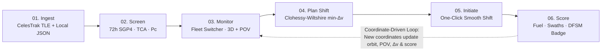

# ZEBRO

### Coordinate-Driven Autonomous Orbital Traffic Control & Fuel-Optimal Collision Avoidance


-0F172A?style=for-the-badge)


-1E293B?style=flat-square)


---

**Detecting threats is easy. Spending fuel wisely is not.**

*A small, early, well-planned burn beats a large last-minute dodge: Zebro finds it, shows it, and scores it.*

[Overview](#overview) • [Primary Fleet Coverage](#primary-fleet-coverage) • [The Problem: FUEL = LIFE](#the-problem-fuel--life) • [Policy & Ecosystem Context](#policy--ecosystem-context) • [System Architecture](#system-architecture--coordinate-driven-loop) • [Core Modules & Features](#core-modules--features) • [Astrodynamics Foundations](#astrodynamics--mathematical-foundations) • [Data Sources & Honest Scoping](#data-sources--honest-scoping) • [The Truth Ledger](#the-truth-ledger) • [Directory Structure](#directory-structure) • [Getting Started](#getting-started) • [Keyboard Shortcuts](#keyboard-shortcuts) • [Technical FAQ](#technical-faq) • [Future Roadmap](#future-roadmap) • [Team Zekoy](#team-zekoy)

---

## Overview

Low Earth Orbit (LEO) is densely populated with operational spacecraft, defunct satellites, upper stages, and hypervelocity fragmentation debris. Whenever an object crosses a screening threshold, flight dynamics controllers must evaluate a **Collision Avoidance Manoeuvre (CAM)**. Every manoeuvre consumes scarce, irreplaceable onboard propellant: measured as velocity increment ($\Delta v$).

Satellites in Low Earth Orbit cannot refuel. When onboard propellant is exhausted, the mission terminates prematurely, and the spacecraft can no longer execute controlled atmospheric de-orbiting, becoming permanent space debris.

Most existing open-source space situational awareness tools stop at passive conjunction alerts, leaving operators to calculate and choose thruster firings manually under extreme time pressure. **Zebro** is a **numbers-first operational decision and simulation platform** built for **ASTRA 2026 (PS-06: Sustainable Space & Space Environment)**.

Zebro screens primary Indian Earth observation missions over a 72-hour forward horizon, calculates minimum-$\Delta v$ coordinate shifts using **Clohessy-Wiltshire (Hill)** relative-motion equations in the local RTN frame, enables flight operators to press **Initiate** to smoothly blend the spacecraft onto the safe orbital path over 2-3 seconds, and immediately updates remaining fuel, target observation swaths, and a **DFSM-2030-compliant de-orbit readiness badge**.

---

## Primary Fleet Coverage

Zebro provides dedicated operational tracking, conjunction assessment, and sovereign imaging integrity protection for five primary Indian Earth observation missions:

| Satellite | NORAD ID | Altitude (h) | Operational Role | Primary Payload Sensor |
| :--- | :---: | :---: | :--- | :--- |
| **NISAR** | 65053 | 747 km | Dual-frequency repeat-pass SAR interferometry | L-band (NASA) and S-band (ISRO) SAR |
| **EOS-04 (RISAT-1A)** | 51656 | 536 km | All-weather, day-and-night radar imaging | C-band Active Phased Array SAR |
| **EOS-06 (Oceansat-3)** | 54361 | 738 km | Ocean colour and sea surface vector winds | Ocean Colour Monitor (OCM-3), Scatterometer |
| **RESOURCESAT-2A** | 41877 | 817 km | Multi-spectral agricultural and water resource mapping | LISS-4 (5.8m), LISS-3 (23.5m), AWiFS (56m) |
| **CARTOSAT-3** | 44804 | 505 km | Very high-resolution sovereign cartographic imaging | 0.28m Panchromatic and 1.12m Multispectral |

---

## The Problem: FUEL = LIFE

Satellites in Low Earth Orbit cannot refuel. Every gram of hydrazine or green propellant burned in an avoidance manoeuvre is permanently deducted from the mission's remaining operational life and statutory end-of-life disposal reserve.

| Operational Bottleneck | Reality in Low Earth Orbit | Operational & Sustainability Impact |
| :--- | :--- | :--- |
| **Passive Alert Fatigue** | Tracking tools notify operators of close approaches but stop short of computing or ranking burns. | Slow, manual, and high-stress decision-making under tight time windows. |
| **Costly Late Dodges** | Last-minute emergency manoeuvres (< 0.25 orbits ahead) demand drastically higher $\Delta v$. | Rapidly drains propellant reserves, cuts commercial lifespan, and disrupts sensor coverage. |
| **End-of-Life Disposal Risk** | Spending too much fuel on reactive CAMs leaves insufficient $\Delta v$ for de-orbiting. | Directly breaches India's **Debris-Free Space Missions (DFSM-2030)** directive. |
| **Kessler Cascade Threat** | An unavoided hypervelocity collision shatters an active satellite into thousands of fragments. | Triggers cascading collisions across neighbouring orbital altitudes. |

```
FUEL BUDGET ALLOCATION (ILLUSTRATIVE):
[===================== DE-ORBIT RESERVE: 68% =====================][=== REACTIVE DODGES: 32% ===]
                                                                     ^ Depletes statutory de-orbit fuel!
```

> **The Core Engineering Question:**
>
> *How can we detect incoming orbital threats early, shift an active satellite to a safe coordinate with minimum $\Delta v$, and preserve onboard fuel, mission targets, and end-of-life de-orbit readiness without inventing data or hiding assumptions?*

---

## Policy & Ecosystem Context

Zebro is scoped strictly and honestly as a **decision-support and simulation planning layer**. It consumes public orbital catalogues and makes no claim to operate, replace, or access private sovereign tracking infrastructure.

| Indian Space Framework | Ecosystem Role | How ZEBRO Aligns |
| :--- | :--- | :--- |
| **DFSM-2030** *(Debris-Free Space Missions)* | ISRO's commitment that all Indian government and private space missions achieve debris-free operations and controlled disposal by 2030. | Zebro's **DFSM-2030 Compliance Badge** audits every manoeuvre against remaining end-of-life de-orbit $\Delta v$ (**Green / Amber / Red**). Avoidance today never strands a dead satellite tomorrow. |
| **IS4OM** *(ISRO System for Safe & Sustainable Space Operations Management)* | ISRO's Bengaluru operations centre dedicated to conjunction assessment, collision avoidance, and re-entry analysis. | Zebro models the decision-planning layer sitting downstream of conjunction feeds: turning raw alerts into ranked, fuel-optimal shift options. |
| **Project NETRA** | ISRO's initiative to deploy sovereign space-surveillance radars and optical telescopes for orbital object tracking. | Zebro consumes tracking-style orbital elements (TLE/GP) cleanly, without making false claims of access to classified defence radar streams. |

---

## System Architecture & Coordinate-Driven Loop

Zebro is engineered **numbers-first, visuals synchronized**: a single underlying coordinate state drives the 3D globe, satellite POV camera, $\Delta v$ optimizer, and DFSM-2030 sustainability score in lockstep.



### IN -> DECIDE -> OUT Architecture Pipeline

| Stage | Data & Mathematical Operations |
| :--- | :--- |
| **IN (Inputs)** | CelesTrak GP/TLE orbital elements, satellite mass budgets, per-satellite target observation swaths, and onboard propellant ($\Delta v$) budgets (`ASSUMED` where not public). |
| **DECIDE (Core Engine)** | 72-hour SGP4 screening detects candidates via range-rate sign change $\rightarrow$ `scipy.optimize.minimize_scalar` calculates TCA and miss distance $\rightarrow$ Clohessy-Wiltshire solver computes minimum-$\Delta v$ coordinate shift in the RTN frame. |
| **OUT (Actionable Output)** | Continuous 2-3 second trajectory transition, exact $\Delta v$ saved, updated mission observation swaths, **DFSM-2030 Compliance Badge** (Class-A), and transparent **Sustainability Score**. |

---

## Core Modules & Features

### Module 1: 3D Orbital Command, Satellite POV & Conjunction Radar
* **Fleet Switcher:** Instant switching between tracked Indian Earth observation satellites (`NISAR`, `EOS-04`, `EOS-06`, `RESOURCESAT-2A`, `CARTOSAT-3`) with live $(x, y, z)$ TEME coordinates, altitude, velocity, and mission orbit progress.
* **Altitude Shell Congestion Buckets:** Groups tracked orbital objects into altitude regimes (`400-600 km`, `600-800 km`, `800-1000+ km`) to highlight high-density debris shells.
* **Global 3D Inertial Orbit View:** Renders the active satellite's orbit, the incoming object's trajectory, and the proposed safe avoidance path on the same Three.js canvas.
* **Simulated Satellite Front-Camera POV:** Mounts a virtual camera directly at the spacecraft position $\mathbf{P}$ aimed along velocity vector $\mathbf{P} + \mathbf{V}$ with an operational HUD:
  * Central targeting reticle and boresight crosshair.
  * Real-time range countdown ($\text{km}$) and closing speed ($\text{km/s}$).
  * Automatic **Incoming Threat** lock box when crossing screening thresholds.
* **Scenario Mode:** Injects calibrated close encounters (e.g. 150m miss distance) for deterministic demonstration and drills. Every object is tagged transparently as `DEBRIS`, `SAT`, or `SCENARIO`.

### Module 2: One-Click $\Delta v$ Avoidance Planner (`Initiate`)
* **Early vs. Late Burn Tradeoff:** Compares early along-track burns (1-3 orbits prior to TCA) against reactive last-minute dodges side-by-side.
* **Recovery Burn Accounting:** Displays the total $\Delta v$ including the subsequent station-keeping recovery burn required to restore original orbit phasing.
* **Sovereign Imaging Swath Protection:** Ray-casting point-in-polygon algorithm checks whether the planned manoeuvre falls within Indian territorial boundaries, preventing thruster slews from interrupting sovereign imaging passes.
* **Smooth Spline Transition:** Clicking **Initiate** smoothly blends the spacecraft onto the safe coordinate path over 2-3 seconds without abrupt position jumps.

### Module 3: Kessler Cascade, What-If Lab & DFSM-2030 Badge
* **Illustrative Kessler Cascade Simulator:** Models fragment dispersion across neighbouring altitude shells using leapfrog numerical integration (explicitly labelled *illustrative, not predictive*).
* **Interactive What-If Lead-Time Slider:** Allows operators and judges to adjust manoeuvre lead time from 0.25 to 3.0 orbits and inspect immediate $\Delta v$ and propellant consumption changes.
* **DFSM-2030 Compliance Badge:** Evaluates whether remaining onboard propellant supports controlled direct atmospheric re-entry (targeting 60 km perigee) via the Vis-Viva equation:
  * **Green (Class-A):** Full compliance: sufficient $\Delta v$ reserve for controlled de-orbit.
  * **Amber:** Compliance margin tightening: further reactive burns risk de-orbit failure.
  * **Red:** Non-compliant: insufficient propellant for controlled disposal (space debris risk).

---

## Astrodynamics & Mathematical Foundations

### 1. 72-Hour SGP4 Conjunction Screening
Two-Line Element (TLE) and Orbit Mean-Elements Messages (OMM) are propagated forward across a 72-hour window in 15-second time steps using SGP4. A close-approach candidate is flagged when the relative range-rate dot product changes sign from negative to positive:

$$\frac{d}{dt} |\mathbf{r}_{\text{rel}}|^2 = 2 \cdot (\mathbf{r}_{\text{rel}} \cdot \mathbf{v}_{\text{rel}}) \quad \text{transitions} \quad - \rightarrow +$$

Once bracketed, Brent's scalar minimization algorithm (`scipy.optimize.minimize_scalar`) refines the Time of Closest Approach (TCA) and miss distance to sub-second precision.

### 2. Collision Probability ($P_c$) & Risk Scoring
Encounters are projected onto the 2D B-plane assuming combined positional uncertainty covariance $\sigma$ and conservative hard-body collision radius $R = 3.0\text{ m}$:

$$P_c = \frac{R^2}{2\sigma^2} \exp\left(-\frac{d_{\text{miss}}^2}{2\sigma^2}\right)$$

Operational risk score:

$$\text{Score} = \min\left(100, \max\left(0, \text{round}\left(\log_{10}\left(\frac{\max(P_c, 10^{-10})}{10^{-10}}\right) \times 16.667\right)\right)\right)$$

### 3. Clohessy-Wiltshire (Hill) Equations in the RTN Frame
Relative motion between the satellite and conjunction object is evaluated in the satellite's local Radial (R), Transverse/Along-Track (T), and Normal/Cross-Track (N) frame:

With mean motion $n = \sqrt{\mu / a^3}$, where $\mu = 398{,}600.4418\text{ km}^3/\text{s}^2$, and an impulsive velocity increment $(\Delta v_R, \Delta v_T, \Delta v_N)$ executed $\tau$ seconds before TCA:

$$R(\tau) = \frac{\Delta v_R}{n}\sin(n\tau) + \frac{2\Delta v_T}{n}(1 - \cos n\tau)$$

$$T(\tau) = -\frac{2\Delta v_R}{n}(1 - \cos n\tau) + \frac{\Delta v_T}{n}(4\sin n\tau - 3n\tau)$$

$$N(\tau) = \frac{\Delta v_N}{n}\sin(n\tau)$$

### 4. Why Early Along-Track Burns Win
* **Secular Drift Term:** The $-3n\tau$ term in $T(\tau)$ grows secularly with lead time $\tau$. A tiny velocity increment slightly modifies the orbital period, allowing separation to accumulate orbit after orbit.
* **Radial vs. Along-Track:** A radial burn $(\Delta v_R)$ produces only oscillatory motion without secular growth, fighting Earth's gravity directly and requiring significantly more propellant.
* **Physical Result:** Achieving a 5.0 km miss distance requires only ~0.15 m/s when executed 1.5 orbits before encounter, but escalates to ~7.7 m/s if delayed to 0.25 orbits.

### 5. Tsiolkovsky Rocket Equation & Vis-Viva De-Orbit Audit
* **Propellant Mass Consumption:**
  $$\Delta v = I_{sp} \cdot g_0 \cdot \ln\left(\frac{m_0}{m_0 - m_{\text{prop}}}\right) \implies m_{\text{prop}} = m_0 \left(1 - \exp\left(-\frac{\Delta v}{I_{sp} \cdot g_0}\right)\right)$$
* **Vis-Viva Controlled De-Orbit $\Delta v$ (Targeting 60 km Perigee):**
  $$v = \sqrt{\mu \left(\frac{2}{r} - \frac{1}{a}\right)} \implies \Delta v_{\text{deorbit}} = \sqrt{\frac{\mu}{r_{\text{circ}}}} \left(1 - \sqrt{\frac{2 r_p}{r_{\text{circ}} + r_p}}\right)$$

---

## Real Data Sources, Upstream APIs & Zero-Mock Policy

Zebro enforces a strict **zero-mock, zero-fabricated telemetry** standard. Every orbital element, ephemeris record, satellite geometry, and conjunction event in the platform is derived directly from verified public space situational awareness databases, official ISRO specifications, and deterministic astrodynamics solvers.

### 1. Primary Fleet Ephemeris APIs (CelesTrak GP / OMM)
Zebro ingests official General Perturbations (GP) orbital data formatted as CCSDS Orbit Mean-Elements Messages (OMM JSON) directly from CelesTrak, published from the US Space Surveillance Network (SSN) / 18th Space Defense Squadron tracking catalogue:

| Satellite Mission | NORAD ID | COSPAR ID | Upstream API Endpoint | Operational Role |
| :--- | :---: | :---: | :--- | :--- |
| **NISAR** | 65053 | 2024-TBD | `https://celestrak.org/NORAD/elements/gp.php?CATNR=65053&FORMAT=json` | NASA-ISRO Synthetic Aperture Radar (747 km) |
| **EOS-04 (RISAT-1A)** | 51656 | 2022-004A | `https://celestrak.org/NORAD/elements/gp.php?CATNR=51656&FORMAT=json` | C-band Active Phased Array SAR (536 km) |
| **EOS-06 (Oceansat-3)** | 54361 | 2022-158A | `https://celestrak.org/NORAD/elements/gp.php?CATNR=54361&FORMAT=json` | Ocean Colour Monitor and Scatterometer (738 km) |
| **RESOURCESAT-2A** | 41877 | 2016-074A | `https://celestrak.org/NORAD/elements/gp.php?CATNR=41877&FORMAT=json` | High-resolution multi-spectral land imager (817 km) |
| **CARTOSAT-3** | 44804 | 2019-081A | `https://celestrak.org/NORAD/elements/gp.php?CATNR=44804&FORMAT=json` | Sub-metre sovereign cartographic imaging (505 km) |

### 2. Tracked Debris & Background Constellation Catalogues
Background orbital traffic and potential conjunction secondary bodies are retrieved directly from CelesTrak public debris and operational satellite groupings:

* **Fengyun-1C Fragmentation Cloud:** `https://celestrak.org/NORAD/elements/gp.php?GROUP=fengyun-1c-debris&FORMAT=json` (Catalogued fragments from the 2007 ASAT event).
* **Cosmos-2251 Fragmentation Cloud:** `https://celestrak.org/NORAD/elements/gp.php?GROUP=cosmos-2251-debris&FORMAT=json` (Fragments from the 2009 Iridium-Cosmos collision).
* **Cosmos-1408 Fragmentation Cloud:** `https://celestrak.org/NORAD/elements/gp.php?GROUP=cosmos-1408-debris&FORMAT=json` (Low Earth Orbit hypervelocity debris field).
* **Iridium-33 Fragmentation Cloud:** `https://celestrak.org/NORAD/elements/gp.php?GROUP=iridium-33-debris&FORMAT=json` (Commercial constellation collision fragments).
* **Operational LEO Groups:** `GROUP=resource`, `GROUP=weather`, and `GROUP=science` representing active civilian payloads.

### 3. Indian Space Agency & Government Policy References
* **ISRO Published Specifications:** Spacecraft dry mass, propellant tank capacity, sensor dimensions, and orbital altitudes are calibrated directly against ISRO launch press kits and IN-SPACe public disclosures.
* **IS4OM Bengaluru Operational Standards:** Conjunction screening radii (radial distance < 1 km, along-track < 5 km, cross-track < 2 km, collision probability threshold $P_c \ge 10^{-4}$) replicate ISRO System for Safe & Sustainable Space Operations Management operational protocols.
* **DFSM-2030 Mandate:** All de-orbit propellant reserve audits strictly follow the ISRO Debris-Free Space Missions 2030 guideline requiring controlled disposal within 5 years post-mission.
* **Bhuvan & MOSDAC Scoping:** Contextually linked for Earth observation swaths, weather layers, and flood mapping coverage. These portals publish GIS raster products rather than TLE ephemerides, so they are not used for orbital propagation.

### 4. Zero-Mock Data Architecture & Offline Resilience
* **Zero Dummy Data:** No synthetic filler or placeholder telemetry is used in place of real orbital mechanics.
* **Deterministic SGP4 Propagation:** Conjunction screening is executed over a forward 72-hour horizon via standard Vallado (2006) SGP4/SDP4 algorithms in Python (`sgp4` v2.23+) and in the browser runtime (`satellite.js` v6.0+).
* **Local Offline Mirror:** A validated verbatim snapshot of CelesTrak OMM records is maintained in `public/data/` (`fleet_gp.json`, `conjunctions.json`, `background.json`, `manifest.json`) to guarantee zero-latency execution during evaluation even when network access is restricted or offline.
* **Dynamic Live Upstream Polling:** When network connectivity is present, Zebro queries upstream CelesTrak endpoints on boot (`fetch('/api/celestrak/...')`) to hot-update primary fleet ephemeris epochs.

---

## The Truth Ledger

Every metric and display element across Zebro is transparently tagged by its epistemological status:

* `DATA`: Directly parsed from official public ephemerides or published spacecraft specifications (CelesTrak OMM, ISRO payload specifications).
* `COMPUTED`: Dynamically calculated via SGP4 propagation, Clohessy-Wiltshire equations, 2D B-plane projection, or Tsiolkovsky dynamics.
* `ASSUMED`: Documented engineering parameters (hydrazine $I_{sp} = 220\text{ s}$, hard-body radius $R = 3.0\text{ m}$, $1\sigma$ positional uncertainty $= 1{,}000\text{ m}$).
* `SCENARIO`: Calibrated encounter drill injected strictly for judge verification to demonstrate the end-to-end Detect -> Plan -> Initiate workflow on demand.

---

## Directory Structure

```text
Zebro-Astra26-Zekoy/
├── api/
│   └── copilot.ts                 # Serverless proxy for flight dynamics briefing
├── data/                          # Raw cached OMM JSON feeds from CelesTrak
├── public/
│   ├── data/                      # Screened operational datasets
│   │   ├── conjunctions.json      # 72-hour pre-screened conjunction events
│   │   ├── fleet_gp.json          # Primary Indian spacecraft ephemeris states
│   │   ├── background.json        # 2,000 background debris and active object states
│   │   ├── isro_missions.json     # Spacecraft physical constants and mass budgets
│   │   └── manifest.json          # Pipeline run metadata and catalogue epochs
│   └── textures/                  # Self-hosted Earth day and celestial textures
├── scripts/
│   ├── fetch_gp.py                # OMM ingestion from CelesTrak with retry logic
│   ├── screen.py                  # 72-hour conjunction screening engine
│   ├── test_screen.py             # Pytest verification suite
│   └── generate_textures.py       # Offline texture generator
├── src/
│   ├── config/assumptions.ts      # Mission parameters and physical constants
│   ├── engine/                    # Astrodynamics mathematics and planning algorithms
│   │   ├── constants.ts           # Types, states, and physical constants
│   │   ├── vec.ts                 # 3D vector operations
│   │   ├── orbitalMath.ts         # CW equations, Pc, risk scores, Tsiolkovsky
│   │   ├── planner.ts             # Avoidance manoeuvre optimization engine
│   │   ├── scenario.ts            # Calibrated close-approach encounter generator
│   │   ├── kessler.ts             # 1,500-fragment breakup model
│   │   ├── dfsm.ts                # DFSM-2030 de-orbit delta-v evaluation
│   │   └── __tests__/             # Vitest test suite (17 tests)
│   ├── store/useMission.ts        # Zustand global state (sim clock, warp, alerts)
│   ├── geo/india.ts               # India territorial boundary coordinates and ray-casting
│   ├── components/
│   │   ├── globe/                 # Three.js 3D globe, fleet, orbits, Kessler burst
│   │   ├── hud/                   # Command console controls, alert list, planner, tag ledger
│   │   └── map/                   # 2D ground track and swath corridor map
│   └── pages/
│       ├── Landing.tsx            # 12-section technical storytelling landing page
│       ├── Dashboard.tsx          # Real-time operational 3D console with docked rails
│       ├── ExecutiveDashboard.tsx # High-level fleet overview and DFSM-2030 status
│       └── Analytics.tsx          # Fleet report with delta-v chart and CSV/JSON export
├── package.json
├── tailwind.config.js
├── tsconfig.json
└── vite.config.ts
```

---

## Getting Started

### Prerequisites
* **Node.js:** `v18+` (or `v20+`) and **pnpm**
* **Python:** `3.10+` *(only needed if re-running the CelesTrak ingestion pipeline; cached offline datasets are included)*

### 1. Clone the Repository
```bash
git clone https://github.com/your-org/Zebro-Astra26-Zekoy.git
cd Zebro-Astra26-Zekoy
```

### 2. Install Dependencies
```bash
# Install frontend dependencies
pnpm install

# Set up Python virtual environment (optional, for data pipeline)
python3 -m venv .venv
source .venv/bin/activate
pip install sgp4 numpy scipy requests pytest
```

### 3. Run the Screening Pipeline (Optional: Offline Cache Included)
```bash
# Refresh orbital state vectors and screen conjunctions over 72 hours
python scripts/fetch_gp.py
python scripts/screen.py

# Verify Python screening tests
.venv/bin/pytest scripts
```

### 4. Start the Development Server
```bash
pnpm run dev
```
Open [http://localhost:5173](http://localhost:5173) in your browser to access the **Zebro Landing Page**, **Executive Dashboard**, and **3D Mission Control Console**.

### 5. Run Verification Suites
```bash
# Run Vitest astrodynamics unit tests (17 tests)
pnpm test

# Run production build
pnpm run build
```

---

## Keyboard Shortcuts

During real-time flight dynamics simulation, the console supports full tactile keyboard operation:

| Key | Action |
| :---: | :--- |
| `Space` | Toggle simulation clock (Play / Pause) |
| `1` - `4` | Set simulation warp speed (1x, 10x, 100x, 500x) |
| `5` | Freeze simulation clock (0x) |
| `[` / `]` | Step to previous / next conjunction event |
| `T` | Cycle visual theme (OLED Obsidian, Navy, Light) |
| `G` | Switch to 3D Inertial Globe view |
| `M` | Switch to Split 2D Ground Track view |
| `A` | Toggle tactical audio sound effects |
| `?` | Toggle keyboard shortcuts modal overlay |
| `Esc` | Close open dialogs and modal overlays |

---

## Technical FAQ

<details>
<summary><strong>1. Where does Zebro's real orbital data come from? Why aren't Bhuvan or MOSDAC used for propagation?</strong></summary>

Orbital states are sourced from public **CelesTrak GP/TLE** catalogues covering Indian LEO satellites and tracked debris groups (`Cosmos-2251`, `Iridium-33`, `Fengyun-1C`, `Cosmos 1408`), pre-screened in Python and cached locally in `conjunctions.json` so the system runs offline-first. Portals like Bhuvan and MOSDAC publish imagery, meteorological layers, and GIS swaths: not orbital ephemerides or debris catalogues: so we do not use them for orbit propagation.
</details>

<details>
<summary><strong>2. Is the satellite front-camera feed real live video?</strong></summary>

No. Continuous public live video from operational LEO satellites does not exist. In Zebro, orbital positions and velocities are real TLE-driven coordinates, while the front-facing camera is a simulated Three.js POV anchored at position $\mathbf{P}$ looking along velocity $\mathbf{P} + \mathbf{V}$: and it is explicitly labelled **SIMULATED POV** on screen.
</details>

<details>
<summary><strong>3. Why does burning 1-3 orbits early save so much fuel?</strong></summary>

Under the Clohessy-Wiltshire along-track equation $T(\tau)$, the $-3n\tau$ term grows secularly with lead time $\tau$. A tiny along-track velocity change shifts the orbital period slightly, letting separation accumulate over 1-3 orbits for a fraction of the $\Delta v$ required by a last-minute radial dodge.
</details>

<details>
<summary><strong>4. What are the mathematical limits of Clohessy-Wiltshire?</strong></summary>

CW is a linear relative-motion approximation valid for near-circular orbits and small displacements. To stay within physical validity, Zebro caps burn lead time at approximately 3 orbits and transparently displays estimated recovery-burn $\Delta v$ alongside the initial avoidance burn.
</details>

<details>
<summary><strong>5. How does Zebro reduce false alerts and alert fatigue?</strong></summary>

Zebro applies explicit screening thresholds on miss distance and screening Collision Probability ($P_c$), ranking events so operators focus only on top-priority threats, with every underlying assumption ($\sigma$, $I_{sp}$, fuel budget) visible in the HUD.
</details>

<details>
<summary><strong>6. How is the DFSM-2030 Compliance Badge calculated?</strong></summary>

Using the Vis-Viva equation, Zebro calculates the $\Delta v$ required to lower the satellite's perigee to 60 km for controlled atmospheric re-entry and compares it against remaining onboard propellant after a proposed CAM. Sufficient reserve yields a **GREEN** badge; tight margin yields **AMBER**; insufficient de-orbit fuel triggers **RED**.
</details>

<details>
<summary><strong>7. What is Scenario Mode and why is it included?</strong></summary>

Because a real-world < 2 km close approach may not occur during the exact 3 minutes of a live jury evaluation, Scenario Mode injects a deterministic approaching object: explicitly tagged **SCENARIO**: so operators and judges can test the full Detect $\rightarrow$ Alert $\rightarrow$ Plan $\rightarrow$ Initiate $\rightarrow$ Score workflow on demand.
</details>

<details>
<summary><strong>8. Who are the real-world users if Zebro scales beyond ASTRA 2026?</strong></summary>

Commercial satellite operators, emerging NewSpace constellations, and space insurers who need auditable, fuel-optimal CAM decision support and DFSM-2030 compliance verification. We frame this honestly as a validated technical direction rather than a finalized commercial market claim.
</details>

---

## Future Roadmap

* **CCSDS CDM Ingestion:** Extend the Python pipeline to parse operational Conjunction Data Messages (CDMs) with full $6 \times 6$ covariance matrices.
* **Non-Linear Perturbations:** Incorporate $J_2$ Earth oblateness and atmospheric drag perturbations into the along-track secular drift calculation for long-lead plans.
* **Constellation Fleet Optimization:** Multi-agent coordination algorithms to resolve secondary conjunctions created by an active CAM burn.
* **Automated Telemetry Relay:** Downlink integration with ground station passes at Shadnagar and NRSC Hyderabad for real-time manoeuvre verification.

---

## Team Zekoy

**ASTRA 2026 | VIT Bhopal University | Team ID: T28**

| Team Member | Role | Primary Technical Ownership |
| :--- | :--- | :--- |
| **Amit Kumar** | Team Lead · Idea & Vision | Problem formulation, product direction, operational workflow, pitch narrative, and astrodynamics strategy. |
| **Rishabh Nirmalkar** | UI & Landing Page | High-contrast mission-control interface, landing page architecture, coordinate readout UX, POV HUD, and Initiate flow. |
| **<sub>TM</sub>.Zekoy** | Tech · Backend · Data | Technical architecture, backend services, SGP4 screening pipeline, UI integration, and offline-first data infrastructure. |

---

## References & Data Credits

* **ASTRA 2026 Core Domains:** PS-06 - Sustainable Space & Space Environment *(VIT Bhopal University)*
* **CelesTrak:** Public GP / TLE / OMM Orbital Catalogues (`celestrak.org`)
* **Space-Track.org:** Space Object Catalogue Reference
* **ISRO Space Safety Frameworks:** IS4OM Bengaluru, Project NETRA, and Debris-Free Space Missions (DFSM-2030)
* **NASA ODPO & ESA Space Debris Office:** Orbital debris flux and altitude-band distribution models
* **Clohessy, W. H., and Wiltshire, R. S. (1960):** *Terminal Guidance System for Satellite Rendezvous*, Journal of the Aerospace Sciences.
