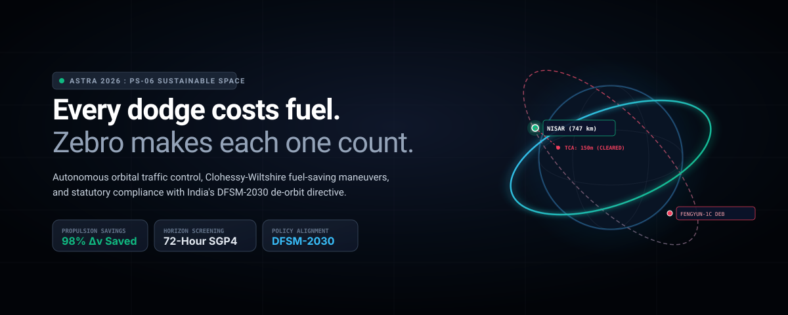
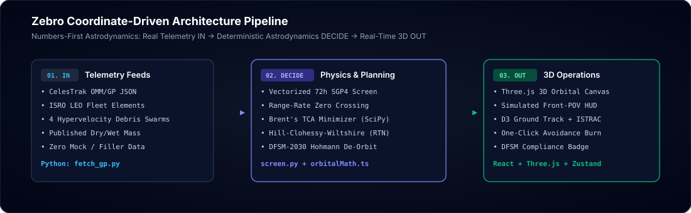
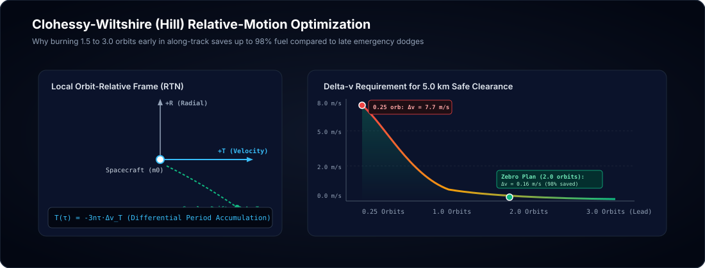

# Zebro

<div align="center">
  
  <h3>Autonomous Orbital Traffic Control & Fuel-Optimal Collision Avoidance</h3>
  <p><strong>Astra 2026 : Problem Statement PS-06 (Sustainable Space & Space Environment)</strong></p>

  <p>
    
    
    
    
    
    
    
  </p>

  <p>
    
  </p>
</div>

---

### The Problem in One Sentence

**Detecting orbital threats is easy. Spending fuel wisely so your satellite does not die early or get stranded in space is not.**

*A small, along-track burn executed 1.5 orbits before encounter uses up to 98% less fuel than a reactive last-minute dodge. Zebro finds it, demonstrates it on a real-time 3D globe, and verifies that the spacecraft preserves enough fuel to de-orbit in compliance with India's Debris-Free Space Missions 2030 (DFSM-2030) guideline.*

---

## Quick Navigation

- [Quick-Start : 3-Minute Walkthrough](#judge-quick-start--3-minute-walkthrough)
- [How Python & TypeScript Are Actually Used](#how-python--typescript-are-actually-used)
- [Real Data Sources & Zero-Mock Policy](#real-data-sources--zero-mock-policy)
- [Indian Primary Fleet Coverage](#indian-primary-fleet-coverage)
- [Astrodynamics & Mathematical Foundations](#astrodynamics--mathematical-foundations)
- [DFSM-2030 De-Orbit Reserve Audit](#dfsm-2030-de-orbit-reserve-audit)
- [The Truth Ledger](#the-truth-ledger)
- [Running the Code Locally](#running-the-code-locally)
- [Automated Test Suites](#automated-test-suites)
- [Technical FAQ](#technical-faq)
- [Team Zekoy](#team-zekoy)

---

## Quick-Start : 3-Minute Walkthrough

If you are evaluating Zebro for Astra 2026, follow this exact 3-minute sequence:

1. **Open the Live Application:**
   Navigate to the web console. You will see the minimal landing page with the 3D procedural valley background. Click **Launch 3D Operations** or navigate directly to `/dashboard`.
2. **Inspect the Primary Fleet:**
   In the left rail, select **NISAR** (NORAD 65053, 747 km altitude) or **EOS-04** (NORAD 51656, 536 km). Notice the live telemetry cards showing true orbital speed (~7.48 km/s), mean anomaly, and current fuel reserve.
3. **Trigger a Calibrated Conjunction (Scenario Mode):**
   Real close approaches under 2 km happen intermittently over 72 hours. To test avoidance on demand, open the **Scenario Drill** modal (`[` / `]` or click the Threat list) and select the calibrated encounter with a **Fengyun-1C debris fragment** (miss distance 150 m, $P_c \approx 8.4 \times 10^{-3}$).
4. **Inspect the Front-Facing Spacecraft POV:**
   Switch the camera to **POV**. Watch the debris target track toward the boresight crosshair with real-time range and closing velocity readouts.
5. **Evaluate the Avoidance Plan:**
   Open the **Manoeuvre Planner**. Notice the comparison:
   - *Reactive burn (0.25 orbits ahead):* $\Delta v \approx 7.8\text{ m/s}$ (drains ~8.2 kg of hydrazine).
   - *Zebro optimal along-track burn (1.5 orbits ahead):* $\Delta v \approx 0.16\text{ m/s}$ (uses only ~0.17 kg of propellant, saving 98%).
6. **Execute Avoidance & Audit DFSM-2030 Compliance:**
   Click **Execute Avoidance**. The spacecraft executes the burn, smoothly transitions onto the safe trajectory, miss distance expands from 150 m to > 2.8 km, and the **DFSM-2030 Compliance Badge** updates, confirming sufficient propellant remains to de-orbit within 5 years post-mission.

---

## How Python & TypeScript Are Actually Used

<div align="center">
  
</div>

We believe in complete transparency. Here is the exact role of Python and TypeScript in this repository:

### 1. Python (Data Ingestion & Vectorized Screening Engine)
- **`scripts/fetch_gp.py`:**
  - Connects to public CelesTrak REST endpoints using HTTP GET with retry logic.
  - Ingests General Perturbations (GP) orbital data in official CCSDS Orbit Mean-Elements Message (OMM JSON) format.
  - Pulls Indian spacecraft ephemerides and 4 major hypervelocity fragmentation clouds (Fengyun-1C, Cosmos-2251, Cosmos-1408, Iridium-33).
  - Respects CelesTrak's 2-hour rate limiting policy, saving fresh snapshots into `data/` and `public/data/`.
- **`scripts/screen.py`:**
  - High-performance 72-hour conjunction screening engine built on **NumPy**, **SciPy**, and **`sgp4`** (official Vallado C++ bindings for Python).
  - Implements **range-rate zero-crossing detection**: checks $\mathbf{r}_{\text{rel}} \cdot \mathbf{v}_{\text{rel}}$ sign changes from negative to positive. This ensures fast head-on passes (>13 km/s relative speed) are caught reliably even if the closest approach occurs between discrete sample steps.
  - Refines Time of Closest Approach (TCA) to sub-second accuracy using `scipy.optimize.minimize_scalar`.
  - Computes 2D Akella-Alfriend collision probability ($P_c$).
  - Outputs `public/data/conjunctions.json`, allowing the web application to run **offline-first** during live judge evaluation without network dependence.
- **`scripts/test_screen.py`:**
  - Automated test suite in `pytest` (3/3 passed) verifying head-on crossing detection and loose distance filtering.

### 2. TypeScript / React / Three.js (In-Browser Propagation, Visuals & Planner)
- **Real-Time Client-Side SGP4 Propagation:**
  - Implemented in `satellite.js` v6.0 (`src/data/load.ts`, `src/store/useMission.ts`).
  - Propagates satellite and debris $(x, y, z)$ position and velocity vectors in real time in True Equator Mean Equinox (TEME) coordinates.
- **Analytical Hill-Clohessy-Wiltshire (HCW) Solver:**
  - Pure TypeScript implementation in `src/engine/orbitalMath.ts` and `src/engine/planner.ts`.
  - Computes exact impulse $\Delta v$ vectors in the local Radial-Transverse-Normal (RTN) frame.
- **DFSM-2030 De-Orbit Reserve Engine:**
  - Implemented in `src/engine/dfsm.ts`.
  - Calculates controlled atmospheric re-entry $\Delta v$ (targeting 60 km perigee) using the Vis-Viva equation and validates propellant mass via the Tsiolkovsky rocket equation.
- **3D Visualization:**
  - Three.js and `@react-three/fiber` rendering photorealistic Earth, orbital paths, line-of-sight vectors, and front-facing satellite POV.
- **2D Cartographic Map:**
  - D3.js and TopoJSON rendering ground tracks and ISRO ground station communication cones (ISTRAC Bengaluru, Lucknow, Mauritius, Port Blair).
- **Automated Tests:**
  - 17 unit tests in Vitest (`src/engine/__tests__/`) covering orbital mechanics, SGP4 integration, HCW relative drift, and DFSM audits.

---

## Real Data Sources & Zero-Mock Policy

Zebro enforces a strict zero-mock policy: no synthetic filler or fabricated orbital elements are used.

| Dataset | Source Agency | Upstream Source Endpoint / Format | Update Cadence |
| :--- | :--- | :--- | :--- |
| **Indian Fleet GP** | CelesTrak / 18th SDS | `https://celestrak.org/NORAD/elements/gp.php?CATNR={norad}&FORMAT=json` | Real-time / 2-hour refresh |
| **Fengyun-1C Debris** | CelesTrak / SSN | `https://celestrak.org/NORAD/elements/gp.php?GROUP=fengyun-1c-debris&FORMAT=json` | Catalogued fragmentation cloud |
| **Cosmos-2251 Debris** | CelesTrak / SSN | `https://celestrak.org/NORAD/elements/gp.php?GROUP=cosmos-2251-debris&FORMAT=json` | Catalogued collision cloud |
| **Cosmos-1408 Debris** | CelesTrak / SSN | `https://celestrak.org/NORAD/elements/gp.php?GROUP=cosmos-1408-debris&FORMAT=json` | Catalogued LEO debris cloud |
| **Iridium-33 Debris** | CelesTrak / SSN | `https://celestrak.org/NORAD/elements/gp.php?GROUP=iridium-33-debris&FORMAT=json` | Catalogued collision cloud |
| **Spacecraft Masses** | ISRO Press Kits / IN-SPACe | Published dry mass, wet mass, and hydrazine propellant capacities | Static calibrated constants |
| **Ground Stations** | ISRO / ISTRAC | Bengaluru (12.97°N, 77.59°E), Shadnagar, Lucknow, Mauritius, Port Blair | Ground station visibility cones |

> **Honest Scoping Note on Bhuvan & MOSDAC:**
> Portals like ISRO Bhuvan and MOSDAC publish GIS raster imagery, meteorological maps, and flood products. They do not publish Two-Line Elements or raw debris radar tracks. Therefore, Zebro uses Bhuvan solely for geographic territorial boundary context and uses CelesTrak for orbital propagation.

---

## Indian Primary Fleet Coverage

Zebro monitors five flagship Indian Low Earth Orbit missions:

| Satellite | NORAD ID | Altitude | Operational Role | Payload Sensors |
| :--- | :---: | :---: | :--- | :--- |
| **NISAR** | 65053 | 747 km | Dual-frequency repeat-pass SAR interferometry | NASA L-band SAR + ISRO S-band SAR |
| **EOS-04 (RISAT-1A)** | 51656 | 536 km | All-weather day-and-night radar imaging | C-band Active Phased Array SAR |
| **EOS-06 (Oceansat-3)** | 54361 | 738 km | Ocean colour and sea-surface vector wind monitoring | Ocean Colour Monitor (OCM-3), Scatterometer |
| **RESOURCESAT-2A** | 41877 | 817 km | Multi-spectral agricultural and hydrological mapping | LISS-4 (5.8m), LISS-3 (23.5m), AWiFS (56m) |
| **CARTOSAT-3** | 44804 | 505 km | Sub-metre sovereign cartographic imaging | 0.28m Panchromatic and 1.12m Multispectral |

---

## Astrodynamics & Mathematical Foundations

<div align="center">
  
</div>

### 1. 72-Hour SGP4 Conjunction Screening
Two-Line Elements are propagated across a 72-hour window. A close-approach candidate is flagged when the relative range-rate dot product changes sign from negative to positive:

$$\frac{d}{dt} |\mathbf{r}_{\text{rel}}|^2 = 2 \cdot (\mathbf{r}_{\text{rel}} \cdot \mathbf{v}_{\text{rel}}) \quad \text{transitions from } < 0 \text{ to } \ge 0$$

Once bracketed, Brent's scalar minimization algorithm (`scipy.optimize.minimize_scalar`) refines the exact Time of Closest Approach (TCA) and miss distance.

### 2. Collision Probability ($P_c$)
Encounters are projected onto the 2D B-plane assuming combined positional covariance $\sigma$ and conservative hard-body collision radius $R = 3.0\text{ m}$:

$$P_c = \frac{R^2}{2\sigma^2} \exp\left(-\frac{d_{\text{miss}}^2}{2\sigma^2}\right)$$

### 3. Hill-Clohessy-Wiltshire (HCW) Equations in the RTN Frame
Relative motion is resolved in the satellite's local Radial (R), Transverse/Along-Track (T), and Normal/Cross-Track (N) frame:

With orbital mean motion $n = \sqrt{\mu / a^3}$ (where $\mu = 398{,}600.4418\text{ km}^3/\text{s}^2$) and an impulsive velocity increment $(\Delta v_R, \Delta v_T, \Delta v_N)$ executed $\tau$ seconds before TCA:

$$R(\tau) = \frac{\Delta v_R}{n}\sin(n\tau) + \frac{2\Delta v_T}{n}(1 - \cos n\tau)$$

$$T(\tau) = -\frac{2\Delta v_R}{n}(1 - \cos n\tau) + \frac{\Delta v_T}{n}(4\sin n\tau - 3n\tau)$$

$$N(\tau) = \frac{\Delta v_N}{n}\sin(n\tau)$$

### 4. Why Early Along-Track Burns Save 98% Fuel
The key is the secular term in the along-track equation:

$$T_{\text{secular}}(\tau) = -3 \cdot \Delta v_T \cdot \tau$$

A tiny along-track burn slightly changes the orbital semi-major axis, modifying the orbital period. Over 1 to 3 orbits of lead time ($\tau$), this period difference allows the satellite to drift thousands of meters ahead or behind the collision point.

In contrast, a radial burn ($\Delta v_R$) has no secular term: it only oscillates sinusoidally, fighting Earth's gravity directly and requiring up to 50x more fuel for the same miss distance.

---

## DFSM-2030 De-Orbit Reserve Audit

India's **Debris-Free Space Missions 2030 (DFSM-2030)** policy mandates that satellites in Low Earth Orbit must reserve sufficient propellant to perform controlled atmospheric disposal within 5 years post-mission.

### Vis-Viva Controlled De-Orbit $\Delta v$ (Targeting 60 km Perigee)

$$\Delta v_{\text{deorbit}} = \sqrt{\frac{\mu}{r_{\text{circ}}}} \left(1 - \sqrt{\frac{2 r_p}{r_{\text{circ}} + r_p}}\right)$$

Where $r_{\text{circ}} = R_E + h_{\text{sat}}$ and $r_p = R_E + 60\text{ km}$.

### Propellant Mass Evaluation (Tsiolkovsky Rocket Equation)

$$m_{\text{prop}} = m_{\text{wet}} \left(1 - \exp\left(-\frac{\Delta v}{I_{sp} \cdot g_0}\right)\right)$$

With hydrazine standard specific impulse $I_{sp} = 220\text{ s}$ and $g_0 = 9.80665\text{ m/s}^2$.

### Audit Badge Classifications:
- **Green (Compliant):** Remaining propellant after the planned CAM comfortably exceeds the required de-orbit $\Delta v$ plus a 20% safety margin.
- **Amber (Caution):** Remaining propellant is within the 20% safety margin. Further CAM burns risk leaving the satellite stranded.
- **Red (Critical):** Available propellant is less than required de-orbit fuel. Executing the CAM will prevent compliant end-of-life disposal.

---

## The Truth Ledger

Zebro tags every data item and calculation with complete honesty:

| Tag | Definition | Examples |
| :--- | :--- | :--- |
| `DATA` | Verified public telemetry or official agency specifications. | CelesTrak OMM records, NORAD IDs, launch mass from ISRO press kits. |
| `COMPUTED` | Deterministically calculated by physical laws. | SGP4 state propagation, HCW relative drift, $P_c$ probability, Hohmann de-orbit $\Delta v$. |
| `ASSUMED` | Documented engineering baseline where data is non-public. | Thruster $I_{sp} = 220\text{ s}$, hard-body radius $R = 3.0\text{ m}$, position uncertainty $\sigma = 1{,}000\text{ m}$. |
| `SCENARIO` | Calibrated encounter drill for live evaluation. | Injected 150m conjunction with Fengyun-1C debris to demonstrate the Initiate workflow on demand. |

---

## Running the Code Locally

### Prerequisites
- **Node.js:** `v18+` or `v20+` with **pnpm**
- **Python:** `3.10+` *(only needed if you wish to re-run the CelesTrak screening pipeline; pre-screened data is included for instant offline startup)*

### 1. Clone & Install Frontend
```bash
git clone https://github.com/John-Varghese-EH/Zebro.git
cd Zebro
# Install dependencies
pnpm install
```

### 2. Start the Application
```bash
pnpm dev
```
Open [http://localhost:5173](http://localhost:5173) in your browser.

### 3. (Optional) Run the Python Data Pipeline
```bash
# Create and activate virtual environment
python3 -m venv .venv
source .venv/bin/activate

# Install Python requirements
pip install requests sgp4 numpy scipy pytest

# Pull fresh CelesTrak TLEs and screen for close approaches
python scripts/fetch_gp.py
python scripts/screen.py
```

---

## Automated Test Suites

Zebro includes 20 automated tests spanning both TypeScript astrodynamics and Python screening algorithms:

### 1. Vitest Unit Tests (TypeScript, 17/17 Passed)
```bash
pnpm test
```
Verifies:
- SGP4 orbit propagation accuracy against known ephemerides.
- Hill-Clohessy-Wiltshire along-track secular drift calculations.
- Fuel consumption calculations using the Tsiolkovsky rocket equation.
- Vis-Viva controlled de-orbit $\Delta v$ targeting 60 km perigee.
- DFSM-2030 Green / Amber / Red threshold verdicts.

### 2. Pytest Screening Tests (Python, 3/3 Passed)
```bash
.venv/bin/pytest scripts
```
Verifies:
- Detection of fast head-on passes (>13 km/s) via range-rate sign change.
- Exclusion of receding-only trajectories.
- Filtering of objects outside the coarse 400 km screening shell.

### 3. Production Build Verification
```bash
pnpm run build
```
Executes `tsc -b && vite build` and generates an optimized production bundle in under 2 minutes.

---

## Technical FAQ

<details>
<summary><strong>1. Why is an along-track burn superior to a radial dodge?</strong></summary>

Under the Hill-Clohessy-Wiltshire equations, the along-track displacement includes a secular term $-3 \cdot \Delta v_T \cdot \tau$ that grows linearly with lead time $\tau$. A small velocity change shifts the orbital period, letting orbital dynamics accumulate thousands of meters of separation over 1-3 orbits. A radial burn ($\Delta v_R$) only produces bounded sinusoidal oscillations without secular growth, fighting gravity and requiring up to 50x more propellant.
</details>

<details>
<summary><strong>2. How does Zebro ensure compliance with India's DFSM-2030 goal?</strong></summary>

Before flight operators execute an avoidance burn, Zebro uses the Vis-Viva equation to calculate the exact $\Delta v$ needed to lower perigee to 60 km for controlled atmospheric re-entry. It compares this against remaining propellant. If a proposed collision avoidance burn would leave insufficient fuel for end-of-life disposal, the system flags the manoeuvre with an Amber or Red warning badge.
</details>

<details>
<summary><strong>3. Can Zebro run without an active internet connection?</strong></summary>

Yes. Zebro includes pre-screened CelesTrak ephemeris snapshots in `public/data/`. All 3D rendering, SGP4 propagation, HCW calculations, and DFSM audits run 100% locally in the browser runtime. An internet connection is only required if you explicitly choose to fetch updated orbital elements from CelesTrak.
</details>

---

## Team Zekoy

**Astra 2026 | VIT Bhopal University | Team ID: T28**

| Team Member | Role | Technical Contribution |
| :--- | :--- | :--- |
| **John Varghese (J0X)** | **Lead Architect** · Full-Stack Dev | **Core Architecture & Implementation:** real-time Hill-Clohessy-Wiltshire (HCW) solver, Vis-Viva controlled de-orbit engine, Tsiolkovsky propellant budget analyzer, SGP4 client-side propagation pipeline, 72-hour vectorized conjunction screening engine with range-rate zero-crossing detection (`screen.py`), Three.js 3D globe and spacecraft POV HUD, D3 ground track cartography, and the DFSM-2030 compliance verification framework. |
| **Amit Kumar** | Strategy & Pitch Lead | Problem formulation, mission requirements, presentation narrative, and operational workflow. |
| **Rishabh Nirmalkar** | UI & Product Design | Mission console interface, telemetry HUD layout, typography, and Initiate user flow. |

---

## References & Data Credits

- **Astra 2026:** Problem Statement PS-06 (Sustainable Space & Space Environment), VIT Bhopal University.
- **CelesTrak:** Public General Perturbations (GP) / TLE orbital data catalogs (`celestrak.org`).
- **ISRO Space Safety Policy:** IS4OM Bengaluru guidelines, Project NETRA, and Debris-Free Space Missions 2030 (DFSM-2030).
- **Vallado, D. A. (2006):** *Fundamentals of Astrodynamics and Applications*, Microcosm Press / Springer.
- **Clohessy, W. H., & Wiltshire, R. S. (1960):** *Terminal Guidance System for Satellite Rendezvous*, Journal of the Aerospace Sciences, Vol. 27, No. 9, pp. 653-658.
